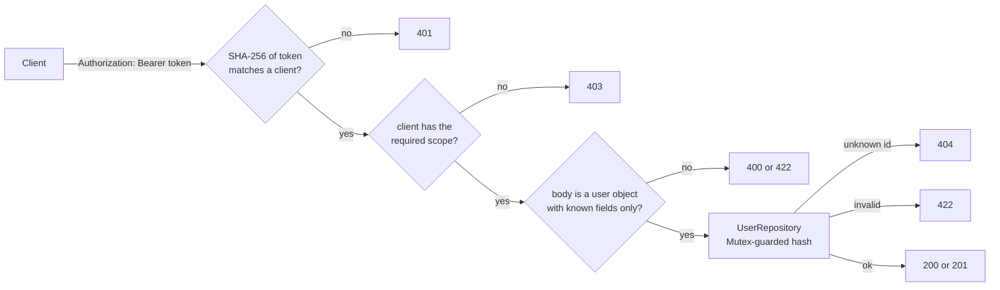

# Fat Zebra users API

A Rails 8.1 JSON API for managing users, built for the Fat Zebra senior engineer take-home. It runs in Docker with one command. Every request needs a bearer token, and each token's scopes decide what it can do.

## Run it

You need Docker and nothing else. The app needs no database, `.env` file or keys.

```sh
git clone https://github.com/JoshTeperman/fat-zebra-users-app.git
cd fat-zebra-users-app
docker compose up --build
```

The API listens on `http://localhost:3000`. Users live in memory, so a restart clears them.

## Try it

There are two development clients. Their tokens are fake and published here on purpose. `compose.yaml` holds only their SHA-256 digests.

| Client | Token | Scope | Can |
| --- | --- | --- | --- |
| reader | `fz-dev-reader-NOT-A-SECRET-0001` | `users:read` | list users |
| writer | `fz-dev-writer-NOT-A-SECRET-0002` | `users:write` | create and update users |

The scopes are independent. The writer can't list users, so creating then listing needs both tokens.

```sh
READER=fz-dev-reader-NOT-A-SECRET-0001
WRITER=fz-dev-writer-NOT-A-SECRET-0002
API=http://localhost:3000/api/v1/users

# Create a user (201)
curl -i -X POST http://localhost:3000/api/v1/users \
  -H "Authorization: Bearer $WRITER" \
  -H "Content-Type: application/json" \
  -d '{"user": {"first_name": "Mark", "last_name": "Hamill", "date_of_birth": "1990-12-10"}}'

# List users (200)
curl -i http://localhost:3000/api/v1/users \
  -H "Authorization: Bearer $READER"

# Update some fields of a user (200)
curl -i -X PATCH http://localhost:3000/api/v1/users/1 \
  -H "Authorization: Bearer $WRITER" \
  -H "Content-Type: application/json" \
  -d '{"user": {"last_name": "Ford"}}'
```

These requests show the application auth boundary:

```sh
# No token (401)
curl -i http://localhost:3000/api/v1/users

# The reader tries to create a user (403)
curl -i -X POST http://localhost:3000/api/v1/users \
  -H "Authorization: Bearer $READER" \
  -H "Content-Type: application/json" \
  -d '{"user": {"first_name": "Ada"}}'

# The writer tries to list users (403)
curl -i http://localhost:3000/api/v1/users \
  -H "Authorization: Bearer $WRITER"
```

Run the specs inside the container (the image runs in development mode, so set the test environment):

```sh
docker compose exec -e RAILS_ENV=test api bundle exec rspec
```

Outside Docker:

```sh
mise install && bundle install
bundle exec rspec
bin/rails server
```

## The brief

Build a small Rails API for users (first name, last name, date of birth) with three endpoints: list, create and update. It must run locally in Docker from a clone, and it must be protected, with the auth mechanism left to the candidate. An in-memory store is fine. A React SPA is a stretch goal. The assessment covers API design, the auth boundary and judgement about scope.

## API

| Method | Path | Scope | Success | Errors |
| --- | --- | --- | --- | --- |
| `GET` | `/api/v1/users` | `users:read` | 200, all users in creation order | 401, 403 |
| `POST` | `/api/v1/users` | `users:write` | 201, the new user | 400, 401, 403, 422 |
| `PATCH` | `/api/v1/users/:id` | `users:write` | 200, the updated user | 400, 401, 403, 404, 422 |

Request bodies wrap attributes in `user`. `POST` needs every field, and `PATCH` changes only the fields it sends.

Success responses wrap the result in `data`:

```json
{"data": {"id": 1, "first_name": "Mark", "last_name": "Hamill", "date_of_birth": "1990-12-10"}}
```

Errors return a list, and each error has a stable `code`, the `field` it concerns and a `message`:

```json
{"errors": [{"code": "forbidden", "field": "scope", "message": "requires the users:write scope"}]}
```

| Status | Codes |
| --- | --- |
| 400 | `parameter_missing` (no `user` object), `malformed_json` |
| 401 | `unauthorized`, with a `WWW-Authenticate: Bearer` header |
| 403 | `forbidden` |
| 404 | `not_found` |
| 422 | `unknown_field`, `invalid_type`, `blank`, `too_long`, `not_a_string`, `invalid_format`, `in_the_future`, `too_old` |

## How a request is handled

The checks run in a fixed order, so a caller learns nothing about the body or the data until it has proved who it is and what it may do.



`Api::V1::BaseController` runs the 401 and 403 checks as `before_action`s for every controller under `/api/v1`. `UsersController` builds the response. `UserRepository` stores the data, and `User` (ActiveModel) owns validation.

## Decisions

| Decision | Why |
| --- | --- |
| In-memory datastore | `User` is a plain ActiveModel class, which still gives typed attributes and validations. Controllers only call `update`, `create`, `all` on the `UserRepository` instance, so a store shared across processes, such as Redis, could replace it without changing the controllers. With Postgres/MySQL etc, I'd follow the Rails convention instead: Active Record models, and no repository. |
| `UserRepository` with Mutex lock | Puma runs on a single process and serves requests on several threads, therefore the Mutex lock stops concurrent conflicting writes on the Users store. Also records are stored as frozen hashes and returned as new `User` objects, so callers can't change stored data by accident. |
| Auth: per-client opaque bearer tokens | The server looks each token up in its client list, and revoking one means removing its entry. JWTs need an issuing step and can't be revoked without a denylist. OAuth needs an authorisation server. Basic would work, but Bearer is the header OAuth uses. |
| No token rotation mechanism | Tokens are server-side config, so currently can be rotated with config change and a redeploy. Possible to add with extension. |
| Scopes derived from controller and action | `index` and `show` need `<controller>:read`, and `create`, `update` and `destroy` need `<controller>:write`. Any other action gets 403. A new controller is protected without any setup. |
| Fail closed at boot | The app refuses to start if `API_CLIENTS` is missing, isn't JSON, or holds a digest that isn't 64 hex characters. |
| Unknown fields rejected with 422 | The client learns immediately when its request doesn't match the API. Silently dropping fields would hide typos and attempts to set `id`. |
| Integer ids | Repository assigns ids in order so users list comes back in order. No additional timestamps are required to sort. Adds a cost that user count is discoverable. |
| No `show` route, no Location header | The brief asks for `index`, `create` and `patch` endpoints, so no `show` url to point to with a `Location` header for 201 responses. |
| Development mode in Docker, port on `127.0.0.1` | Production mode needs `config/master.key`, which a cloned repo doesn't have. Binding to loopback keeps the plain-HTTP dev server off the network. |
| No CSRF protection | Credentials travel only in the headers, never a cookie, so CSRF doesn't apply. |

## Trade-offs accepted

- Data is lost on restart, and the app can't scale beyond one process.
- Changing a client means editing `compose.yaml` and rerunning `docker compose up`. Tokens don't expire.
- Any `users:write` client can update any user. There's no per-record authorisation.
- Renaming a controller renames its scopes.
- Integer ids reveal how many users exist.
- The local server runs plain HTTP. Bearer tokens need TLS anywhere else.

## With more time

- A database and Active Record models in place of the repository.
- A rotation endpoint, with tokens stored in a secrets manager, or a token table.
- TLS terminated at a proxy, with `force_ssl` as a backstop.
- Rate limiting.
- A `show` route with a `Location` header.
- A React SPA frontend.

## How this was built

I made the design decisions, wrote or co-wrote the code with Claude, and reviewed and merged every pull request. Claude worked with [my execution-time skill](https://github.com/JoshTeperman/agent-skills-sync/tree/main/skills/execution-time), a custom fork of poteto-mode, from [Lauren Tan's pstack plugin](https://github.com/cursor/plugins/blob/main/pstack/skills/poteto-mode/SKILL.md), and followed a plan written in conjunction with Grok.
