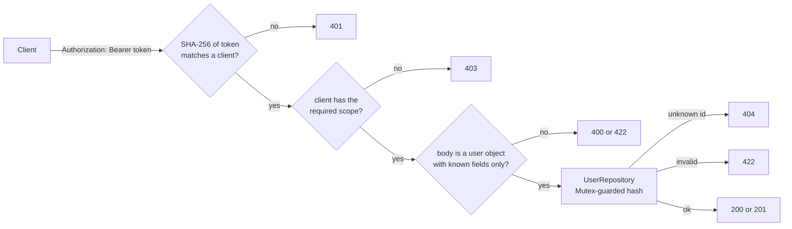

# Fat Zebra users API

A Rails 8.1 JSON API for managing users, built for the Fat Zebra senior engineer take-home. It runs in Docker with one command. Every request needs a bearer token, and each token's scopes decide what it can do.

## Run it

You need Docker and nothing else. The app needs no database, `.env` file or keys.

```sh
git clone https://github.com/JoshTeperman/fat-zebra-users-app.git
cd fat-zebra-users-app
docker compose up --build
```

The API listens on `http://localhost:3000`. Users live in memory, so a restart clears them.

## Try it

There are two development clients. Their tokens are fake and published here on purpose. `compose.yaml` holds only their SHA-256 digests.

| Client | Token | Scope | Can |
| --- | --- | --- | --- |
| reader | `fz-dev-reader-NOT-A-SECRET-0001` | `users:read` | list users |
| writer | `fz-dev-writer-NOT-A-SECRET-0002` | `users:write` | create and update users |

The scopes are independent. The writer can't list users, so creating then listing needs both tokens.

```sh
READER=fz-dev-reader-NOT-A-SECRET-0001
WRITER=fz-dev-writer-NOT-A-SECRET-0002
API=http://localhost:3000/api/v1/users

# Create a user: 201
curl -i -X POST $API -H "Authorization: Bearer $WRITER" -H "Content-Type: application/json" \
  -d '{"user": {"first_name": "Ada", "last_name": "Lovelace", "date_of_birth": "1990-12-10"}}'

# List users: 200
curl -i $API -H "Authorization: Bearer $READER"

# Update one field: 200
curl -i -X PATCH $API/1 -H "Authorization: Bearer $WRITER" -H "Content-Type: application/json" \
  -d '{"user": {"last_name": "King"}}'

# No token: 401
curl -i $API

# Reader tries to write: 403
curl -i -X POST $API -H "Authorization: Bearer $READER" -H "Content-Type: application/json" \
  -d '{"user": {"first_name": "Ada"}}'
```

Run the specs inside the container (the image runs in development mode, so set the test environment):

```sh
docker compose exec -e RAILS_ENV=test api bundle exec rspec
```

Outside Docker, with Ruby 4.0.8 ([mise](https://mise.jdx.dev) reads `mise.toml`, which pins Ruby and sets the same `API_CLIENTS`):

```sh
mise install && bundle install
bundle exec rspec
bin/rails server
```

## The brief

Build a small Rails API for users (first name, last name, date of birth) with three endpoints: list, create and update. It must run locally in Docker from a clone, and it must be protected, with the auth mechanism left to the candidate. An in-memory store is fine. A React SPA is a stretch goal. The assessment covers API design, the auth boundary and judgement about scope.

## API

| Method | Path | Scope | Success | Errors |
| --- | --- | --- | --- | --- |
| `GET` | `/api/v1/users` | `users:read` | 200, all users in creation order | 401, 403 |
| `POST` | `/api/v1/users` | `users:write` | 201, the new user | 400, 401, 403, 422 |
| `PATCH` | `/api/v1/users/:id` | `users:write` | 200, the updated user | 400, 401, 403, 404, 422 |

Request bodies wrap attributes in `user`. `POST` needs every field, and `PATCH` changes only the fields it sends.

| Field | Rule |
| --- | --- |
| `first_name`, `last_name` | Required string, trimmed, 50 characters at most |
| `date_of_birth` | Required, `YYYY-MM-DD`, from 1900-01-01 to today |

Success responses wrap the result in `data`. Errors return a list, and each error has a stable `code`, the `field` it concerns and a `message`:

```json
{"data": {"id": 1, "first_name": "Ada", "last_name": "Lovelace", "date_of_birth": "1990-12-10"}}
{"errors": [{"code": "forbidden", "field": "scope", "message": "requires the users:write scope"}]}
```

| Status | Codes |
| --- | --- |
| 400 | `parameter_missing` (no `user` object), `malformed_json` |
| 401 | `unauthorized`, with a `WWW-Authenticate: Bearer` header |
| 403 | `forbidden` |
| 404 | `not_found` |
| 422 | `unknown_field`, `invalid_type`, `blank`, `too_long`, `not_a_string`, `invalid_format`, `in_the_future`, `too_old` |

## How a request is handled

The checks run in a fixed order, so a caller learns nothing about the body or the data until it has proved who it is and what it may do.



`Api::V1::BaseController` runs the 401 and 403 checks as `before_action`s for every controller under `/api/v1`. `UsersController` builds the response. `UserRepository` stores the data, and `User` (ActiveModel) owns validation.

## Decisions

| Decision | Why |
| --- | --- |
| Rails API-only app, no Active Record | The brief allows an in-memory store. `User` is an ActiveModel class, so validations look and behave as they would on a database model. |
| In-memory `UserRepository` behind one `Mutex` | Puma serves requests on several threads, and the lock stops concurrent writes from racing on the id counter or the hash. It stores frozen copies, so callers can't change stored data by accident. |
| Single Puma process (`workers 0`) | Each process would have its own store. `config/puma.rb` ignores `WEB_CONCURRENCY` so there is only one. |
| Opaque bearer token per client | One token identifies one client, and the server can revoke it by removing its entry. JWTs can't be revoked early without a denylist, and OAuth needs an authorisation server. Neither is needed for machine clients here. |
| Only digests in config | `API_CLIENTS` in `compose.yaml` holds SHA-256 digests, compared with `secure_compare`. Code and config hold no plaintext tokens. |
| Uniform 401 | A missing token, an unknown token and a token sent with another scheme such as `Basic` all get the same response, so it reveals nothing about which tokens exist. |
| Scopes derived from controller and action | `index` and `show` need `<controller>:read`, and `create`, `update` and `destroy` need `<controller>:write`. Any other action gets 403. A new controller is protected without any setup. |
| Fail closed at boot | The app refuses to start if `API_CLIENTS` is missing, isn't JSON, or holds a digest that isn't 64 hex characters. |
| Auth before body parsing | A reader sending malformed JSON gets 403, not 400. |
| Unknown fields rejected with 422 | Silently dropping them would hide typos and attempts to set `id`. |
| Integer ids, no `show` route | The brief asks for three endpoints. Without `show`, `POST` returns no `Location` header. |
| Development mode in Docker, port on `127.0.0.1` | Production mode needs `config/master.key`, which a clone doesn't have. Binding to loopback keeps the plain-HTTP dev server off the network. |
| Tokens only from the header | They are never read from the query string. `authorization` and `token` are filtered from logged parameters. |

## Trade-offs accepted

- Data is lost on restart, and the app can't scale beyond one process.
- Changing a client means editing `compose.yaml` and restarting. Tokens don't expire.
- Any `users:write` client can update any user. There's no per-record authorisation, audit log or rate limiting.
- Renaming a controller renames its scopes.
- Integer ids reveal how many users exist.
- The local server runs plain HTTP. Bearer tokens need TLS anywhere else.
- In development mode, a path with no route returns Rails' debug 404 page instead of the API error shape.

## With more time

- Postgres and Active Record models in place of the repository.
- Clients in a database table (digest, scopes, created, last used, revoked), or tokens in a secrets manager, with a rotation endpoint and an overlap window.
- OAuth 2.0 client credentials with short-lived tokens, if third parties need to get their own tokens or user login is added. Clients already send `Authorization: Bearer`, so only the server side changes.
- TLS terminated at a proxy or load balancer, with `force_ssl` as a backstop.
- Rate limiting, starting with repeated 401s, and pagination on the list.
- A `show` route with a `Location` header, and a health route once it's deployed.
- The React SPA from the stretch goal.

## Layout

```text
app/controllers/api/v1/base_controller.rb   authentication, scopes, error responses
app/controllers/api/v1/users_controller.rb  index, create, update
app/models/user.rb                          attributes and validation
app/models/api_client_registry.rb           parses API_CLIENTS, finds a client by token
app/repositories/user_repository.rb         in-memory store
config/locales/en.yml                       error messages under api.errors
spec/                                       model, repository, registry and request specs
```

CI (`.github/workflows/ci.yml`) runs RSpec, RuboCop, Brakeman and bundler-audit on every pull request. `bin/ci` runs the same checks locally.

## How this was built

I made the design decisions, wrote parts of the code, and reviewed and merged every pull request. Claude Code wrote most of the code and specs from written plans, and its commits carry a `Co-Authored-By` trailer. Grok helped plan the work and review it.

An earlier version, with a React client, is kept for reference at [fat-zebra-users-api](https://github.com/JoshTeperman/fat-zebra-users-api).
